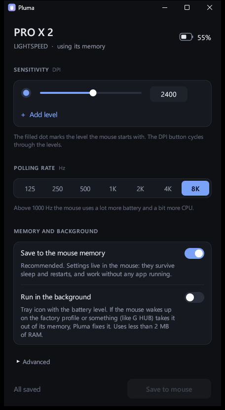

# Pluma

An ultralight configurator for Logitech G mice on Windows. A minimal alternative to G HUB.

<p align="center"></p>

## Why

G HUB uses hundreds of MB of RAM and leaves the mouse in *software mode*: the DPI depends on the
app running and is lost whenever the mouse goes to sleep. Pluma saves your settings **to the
mouse's own memory**, so they always work, even with no app running.

|  | G HUB | Pluma |
|---|---|---|
| RAM in the background | ~270 MB (4 processes) | 0.4 MB (optional) |
| RAM with the window open | — | ~11 MB |
| Disk space | ~2 GB | 1.6 MB (a single `.exe`) |
| Settings without the app running | No (software mode) | Yes (mouse memory) |

## Features

- **DPI**: up to 5 levels, using the sensor's real range.
- **Polling rate**: 125 Hz to 8 kHz, depending on the mouse.
- **Mouse memory**: saves your settings to the mouse profile, with an automatic backup and a
  restore button.
- **Background agent (optional)**: tray icon with the battery level. If the mouse falls back to
  its factory profile, Pluma fixes it.
- **Detects G HUB** and offers to close it, since both fight over control of the mouse.

## Usage

Download `Pluma.exe` from [Releases](../../releases) and run it. No installation needed.

Tested with the **PRO X 2 (Superlight 2)**. It should work with Logitech G mice that use
HID++ 2.0, over LIGHTSPEED or cable, on Windows 10/11. Lighting, button remapping and macros
aren't supported.

## Building

Requires [Rust](https://rustup.rs) with the `stable-x86_64-pc-windows-gnu` toolchain (no Visual Studio needed).

```powershell
.\build.ps1   # outputs dist\Pluma.exe
```

## License

[MIT](LICENSE)
